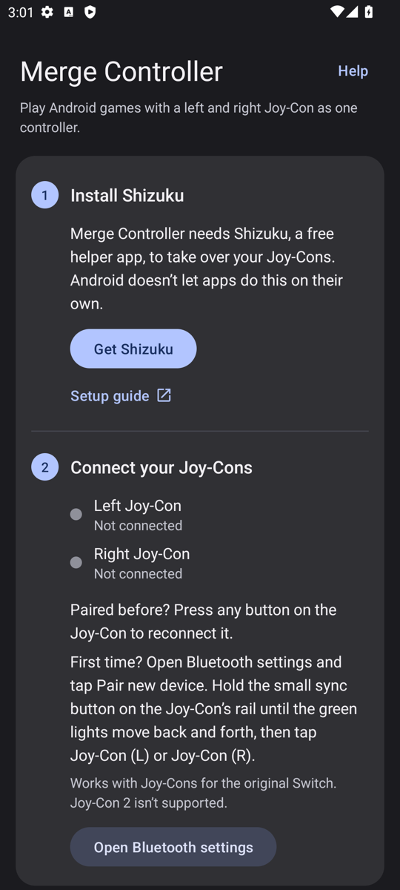
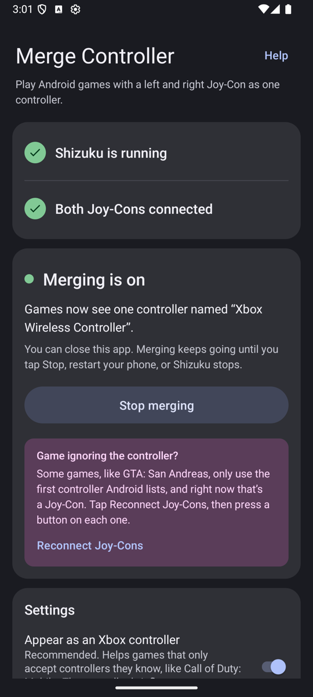

# Merge Controller

**Play Android games with a left and right Nintendo Switch Joy-Con as one controller.**

  
  &nbsp;
  

Android treats a pair of Joy-Cons as two separate half-controllers, and most games can't use them together. Merge Controller combines them into one virtual controller, so your game sees a single, complete gamepad.

- **One controller:** both sticks, the D-pad, every button and both triggers.
- **Works with picky games:** it can appear as an Xbox Wireless Controller, which games like Call of Duty: Mobile recognize.
- **Rumble:** vibration from games is passed on to the Joy-Cons.
- **Set and forget:** merging keeps running in the background, and a Joy-Con that falls asleep is picked up again when it reconnects.
- **No root needed:** it uses [Shizuku](https://shizuku.rikka.app/) instead.
- **Free and open source**, with no ads, no internet access and no data collection.

## What you need

- An Android phone or tablet with **Android 12 or newer** (64-bit)
- A pair of **Joy-Cons for the original Nintendo Switch** (Joy-Con 2 isn't supported)
- **[Shizuku](https://shizuku.rikka.app/)**, a free app that gives Merge Controller the access it needs (see below)
- A phone that supports Joy-Cons over Bluetooth. Most recent phones do, and after pairing, the app tells you if yours doesn't.

## Install

1. On your phone, download the latest **`MergeController-*.apk`** from the [Releases page](https://github.com/ermay12/merge-controller/releases/latest).
2. Open the downloaded file and tap **Install**. If Android asks, allow your browser or Files app to install apps.

## Set up

The app walks you through these steps; this section adds a little more detail.

### 1. Install and start Shizuku

Android doesn't let regular apps take over a controller or create a new one. Shizuku lets apps use the same access that Android's developer tools have, without rooting your phone. Merge Controller uses it to hide the Joy-Cons from games and create the combined controller.

1. Install **Shizuku** from [Google Play](https://play.google.com/store/apps/details?id=moe.shizuku.privileged.api) (or from its [GitHub releases](https://github.com/RikkaApps/Shizuku/releases)).
2. Open Shizuku and start it. Pick the option that fits you:
   - **No computer (most people):** tap **Start via Wireless debugging** and follow Shizuku's **Step-by-step guide**. You'll turn on Developer options, turn on Wireless debugging, and pair Shizuku with a code. Your phone needs to be on Wi-Fi. The first time takes a few minutes; after that, it's quicker.
   - **With a computer:** connect your phone over USB with USB debugging on, then run the command Shizuku shows under **Start by connecting to a computer**.
   - **Rooted phone:** tap **Start (for rooted devices)**.

> [!NOTE]
> **Shizuku stops whenever your phone restarts.** After each restart, open Shizuku and start it again the same way (on a rooted phone, Shizuku can start itself at boot). Merge Controller shows **Start Shizuku again** when it's needed.

Shizuku's [official setup guide](https://shizuku.rikka.app/guide/setup/) has screenshots of every step.

### 2. Pair your Joy-Cons

1. Open **Bluetooth settings** on your phone (the app has a button for this) and tap **Pair new device**.
2. On the Joy-Con, hold the small round **sync button** on the rail until the green lights move back and forth.
3. Tap **Joy-Con (L)** or **Joy-Con (R)** in the list.
4. Repeat for the other Joy-Con.

You only pair once. After that, pressing any button on a Joy-Con reconnects it.

### 3. Start merging

1. Open **Merge Controller**, tap **Allow access**, and choose **Allow all the time**.
2. Tap **Start merging**.
3. When the app says **Merging is on**, close it and open your game.

Merging keeps running until you tap **Stop merging**, restart your phone, or Shizuku stops.

## Settings

| Setting | What it does |
|---|---|
| **Appear as an Xbox controller** | On by default. The merged controller presents itself as an Xbox Wireless Controller, because some games only accept controllers they recognize. Turn it off to have it show up as "Merged Joy-Con Controller". |
| **Nintendo button layout** | Off (default): buttons work by position, like an Xbox controller, so the bottom button is A. Most Android games expect this. On: buttons follow the letters printed on the Joy-Con, so the button marked A is A. |
| **Rumble** | Passes vibration from games on to the Joy-Cons: strong rumble to the left Joy-Con, light rumble to the right. **Test rumble** tries it out. |

**Test your controller** shows each button you press and where the sticks are, so you can check everything works before you start a game.

### Button layout

| Joy-Con | What games see (Xbox naming) |
|---|---|
| Left stick, right stick | Left stick, right stick |
| Arrow buttons | D-pad |
| L, R | LB, RB |
| ZL, ZR | LT, RT |
| B, A, Y, X (by position) | A, B, X, Y. With **Nintendo button layout** on: B, A, Y, X |
| − and + | View and Menu (Back and Start) |
| Home | Xbox / Home button |
| Capture | Share (C button with **Appear as an Xbox controller** off) |
| Stick presses | Left and right stick click |

SL and SR aren't used, and motion controls aren't supported.

## Troubleshooting

**The app says "Start Shizuku again."**
Your phone restarted, which stops Shizuku. Open Shizuku and start it again (see [step 1](#1-install-and-start-shizuku)).

**My Joy-Con shows "Not connected."**
Press any button on it to wake it up. If it was never paired, or was paired to a Switch since, pair it again (see [step 2](#2-pair-your-joy-cons)).

**The app says "This phone can't use Joy-Cons" / "Paired, but not supported."**
To use Joy-Cons as controllers, a phone's system software needs a Joy-Con driver, which the phone maker either includes or leaves out. (Technically: Android's kernel needs the `hid-nintendo` driver.) Most recent phones have it, but some don't, and an app can't add it. On those phones, Merge Controller can't work, short of rooting and installing a custom kernel.

**A game ignores the merged controller.**
- Some games, like GTA: San Andreas, only use the first controller Android lists. If your Joy-Cons connected before you started merging, they're first. Merge Controller shows a tip in this case: tap **Reconnect Joy-Cons**, then press a button on each Joy-Con. This works even while the game is running.
- Some games only accept controllers they recognize. Make sure **Appear as an Xbox controller** is on.

**A and B (or X and Y) are swapped.**
Toggle **Nintendo button layout**.

**Rumble doesn't work.**
Check that **Rumble** is on and that **Test rumble** works. Rumble uses Android Bluetooth features that aren't officially public. It has been tested with real Joy-Cons on Android 17, and the Bluetooth features it needs are also there on Android 13 and 16. If it doesn't work on your phone, please [open an issue](https://github.com/ermay12/merge-controller/issues) with your phone model and Android version.

**Games still list the original Joy-Cons.**
That's expected. Without root, Android keeps listing the original Joy-Cons, but while merging, they send nothing to games.

**Something else?**
[Open an issue](https://github.com/ermay12/merge-controller/issues). Include your phone model, Android version, and what the app's **Advanced** section shows.

## Limitations

- Android still lists the original Joy-Cons while merging (they're silent). A game that picks the first listed controller may need **Reconnect Joy-Cons** (see above).
- Motion controls (gyro) aren't available on the merged controller.
- Only original Switch Joy-Cons are supported: no Joy-Con 2, Pro Controller, or single sideways Joy-Con.
- Rumble relies on Android features that aren't officially public, so a future Android update could break it. Merging itself would keep working.

## How it works

Merge Controller runs a small background service through Shizuku, with the same permissions as Android's developer tools. The service takes exclusive hold of both Joy-Cons, so games stop receiving their input. It then creates a virtual gamepad that combines them, and forwards rumble back to the Joy-Cons over Bluetooth. The service keeps running after you close the app.

For technical details and build instructions, see [BUILDING.md](BUILDING.md).

## AI Disclaimer

This app was completely vibecoded with Opus 5.5.

I only provided design direction and testing.

## License

Merge Controller is free software, licensed under the [GNU General Public License v3.0](LICENSE) or (at your option) any later version. You may use, study, share and modify it. If you distribute a modified version, you must release its source code under the same license.

Copyright © 2026 Eric Maynard

## Acknowledgments

- [Shizuku](https://github.com/RikkaApps/Shizuku) by RikkaApps, which makes this possible without root
- [dekuNukem's Nintendo Switch reverse engineering notes](https://github.com/dekuNukem/Nintendo_Switch_Reverse_Engineering), for the Joy-Con rumble format
- The Linux kernel's `hid-nintendo` driver

*Merge Controller is not affiliated with or endorsed by Nintendo or Microsoft. Nintendo Switch and Joy-Con are trademarks of Nintendo. Xbox is a trademark of Microsoft.*
